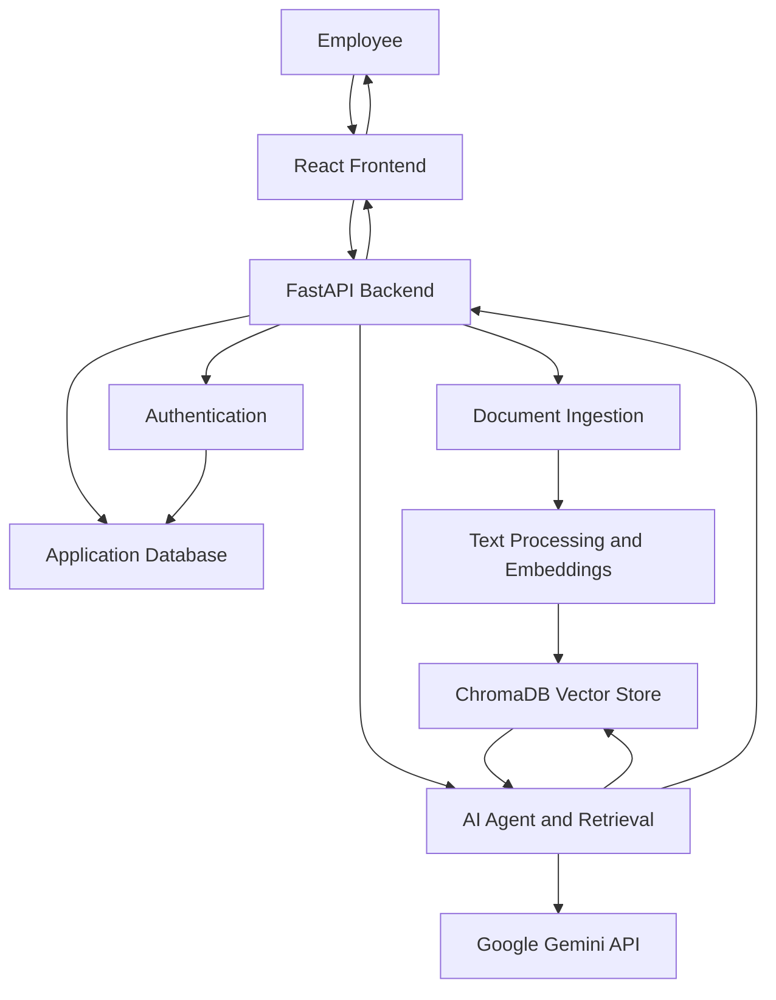

# HUMANLY — HR Policy Intelligence Agent

**An AI-powered HR policy assistant designed to make workplace policies easier to access, understand, and navigate.**

HUMANLY is a full-stack application designed to help employees find information about HR policies through a conversational interface. The project combines a React frontend with a FastAPI backend and a retrieval-based AI architecture intended to provide relevant, context-aware answers to HR policy questions.

Instead of manually searching lengthy policy documents, users will be able to ask questions in natural language and receive clear, relevant responses based on available HR policy information.

> **Project status:** The interactive frontend is implemented. Backend services and AI-powered policy retrieval are under development and integration.

---

## Table of Contents

* [Project Overview](#-project-overview)
* [Key Features](#-key-features)
* [Technology Stack](#-technology-stack)
* [System Architecture](#-system-architecture)
* [Project Structure](#-project-structure)
* [Getting Started](#-getting-started)
* [Environment Configuration](#-environment-configuration)
* [Backend Setup](#-backend-setup)
* [Frontend Setup](#-frontend-setup)
* [API Documentation](#-api-documentation)
* [Security Considerations](#-security-considerations)
* [Current Status and Future Enhancements](#-current-status-and-future-enhancements)
* [Author](#-author)

---

## 📌 Project Overview

HR policies often contain important information about leave entitlements, compensation, employee eligibility, workplace conduct, and organizational procedures. Finding the correct information in lengthy documents can be time-consuming.

HUMANLY aims to simplify this process through a conversational AI interface backed by semantic document retrieval.

The application is designed around three main components:

* **Conversational interface:** Provides an intuitive space for employees to ask HR-related questions.
* **Backend services:** Manage API requests, authentication, document processing, and supporting application logic.
* **AI-powered retrieval:** Uses document embeddings, vector search, and language-model integration to support policy question answering.

The goal is to make HR information more accessible while keeping answers grounded in the organization's available policy documents.

## ✨ Key Features

### Interactive AI Assistant

* Conversational interface for HR-related questions.
* Suggested topics covering leave, holidays, salary, benefits, and workplace policies.
* Chat interface designed for a straightforward employee experience.

### Policy Library

* Dedicated interface for exploring HR policy topics.
* Search interface for finding relevant policy categories.
* Structured presentation of policy-related information.

### Conversation History

* Conversation management within the frontend.
* Access to recent conversations.
* Ability to start a new conversation and manage history entries.

### Activity Dashboard

* Dedicated My Activity page.
* Summary statistics and conversation history presentation.

### AI and Backend Architecture

The backend is designed to support:

* REST API endpoints using FastAPI.
* Authentication and access-control functionality.
* Document ingestion and processing.
* Semantic retrieval using embeddings and ChromaDB.
* AI-agent orchestration using LangGraph.
* Language-model integration through Google's Gemini API.
* PostgreSQL-backed application data.

**Development note:** The frontend currently demonstrates its interactive functionality using demo responses. Live, document-grounded answers depend on completing and connecting the backend retrieval pipeline.

---

## 🛠️ Technology Stack

| Component        | Technologies             |
| ---------------- | ------------------------ |
| Frontend         | React, JavaScript, Vite  |
| Styling          | CSS3, responsive layouts |
| Backend          | Python, FastAPI          |
| Database         | PostgreSQL, SQLAlchemy   |
| Vector Database  | ChromaDB                 |
| Embeddings       | Sentence Transformers    |
| AI Orchestration | LangGraph                |
| Language Model   | Google Gemini API        |
| Authentication   | JWT-based authentication |
| Version Control  | Git and GitHub           |

---

## 🏗️ System Architecture

HUMANLY follows a modular architecture that separates the user interface, backend services, database, and AI retrieval components.



### How the system is intended to work

1. An employee submits an HR-related question through the frontend.
2. The frontend sends the request to the FastAPI backend.
3. The backend processes the request and retrieves relevant policy information.
4. The retrieval component searches indexed document embeddings in ChromaDB.
5. The AI component uses the retrieved context to generate a relevant response.
6. The response is returned to the frontend for display.

The complete document-grounded workflow depends on successful backend integration, database configuration, and policy document indexing.

---

## 📁 Project Structure

The repository is organized into separate frontend and backend directories.

```text
hr-policy-agent/
│
├── backend/
│   ├── app/
│   │   ├── agent/
│   │   ├── auth/
│   │   ├── db/
│   │   ├── ingestion/
│   │   ├── retrieval/
│   │   ├── routes/
│   │   ├── config.py
│   │   ├── main.py
│   │   └── __init__.py
│   │
│   ├── evaluation/
│   ├── models/
│   ├── .env.example
│   ├── create_admin.py
│   └── requirements.txt
│
├── frontend/
│   ├── public/
│   ├── src/
│   │   ├── assets/
│   │   ├── services/
│   │   │   └── api.js
│   │   ├── App.css
│   │   ├── App.jsx
│   │   ├── index.css
│   │   └── main.jsx
│   ├── .env.example
│   └── package.json
│
├── .gitignore
├── API.md
└── README.md
```

### Directory responsibilities

| Directory or file              | Purpose                               |
| ------------------------------ | ------------------------------------- |
| `frontend/src/`                | React interface and styling           |
| `frontend/src/services/api.js` | Frontend API service                  |
| `backend/app/agent/`           | AI-agent functionality                |
| `backend/app/auth/`            | Authentication components             |
| `backend/app/db/`              | Database configuration and operations |
| `backend/app/ingestion/`       | Document ingestion and processing     |
| `backend/app/retrieval/`       | Policy retrieval components           |
| `backend/app/routes/`          | API route definitions                 |
| `backend/app/config.py`        | Backend configuration                 |
| `backend/app/main.py`          | FastAPI application entry point       |
| `backend/evaluation/`          | Evaluation-related components         |
| `backend/models/`              | Application model definitions         |
| `API.md`                       | API reference documentation           |

---

## 🚀 Getting Started

Follow these instructions to run the project locally.

### Prerequisites

Install the following software:

* Python 3.12
* Node.js and npm
* PostgreSQL
* Git
* A Google Gemini API key for AI functionality

Verify your installations:

```bash
python --version
node --version
npm --version
git --version
```

### 1. Clone the Repository

```bash
git clone https://github.com/khushi1911/hr-policy-agent.git
```

Navigate into the project directory:

```bash
cd hr-policy-agent
```

### 2. Configure the Backend Environment

Navigate to the backend directory:

```bash
cd backend
```

Create a Python virtual environment:

```bash
python -m venv .venv
```

Activate it on Windows PowerShell:

```powershell
.\.venv\Scripts\Activate.ps1
```

Install the backend dependencies:

```bash
python -m pip install -r requirements.txt
```

### 3. Configure PostgreSQL

Ensure that PostgreSQL is running.

Create the application database using PostgreSQL:

```sql
CREATE DATABASE hr_policy_agent;
```

Configure the database connection string in your backend environment file.

The database username, password, host, and port must match your local PostgreSQL configuration.

### 4. Configure Environment Variables

Create a `.env` file inside the `backend/` directory using `.env.example` as your reference.

Configure the required values, including:

```dotenv
DATABASE_URL=your_postgresql_connection_string
JWT_SECRET=your_generated_secret
GEMINI_API_KEY=your_gemini_api_key
GEMINI_MODEL=your_configured_gemini_model
```

Use the actual variable names and supported model settings from your project's configuration files.

**Important:** These values are examples of configuration fields, not credentials. Generate your own JWT secret and use your own API key. Never commit the real `.env` file to GitHub.

### 5. Start the Backend

From the `backend/` directory, run:

```bash
python -m uvicorn app.main:app --reload --host 127.0.0.1 --port 8000
```

If the application starts successfully, the API should be available at:

`http://127.0.0.1:8000`

The exact startup requirements depend on your database configuration and backend implementation.

### 6. Start the Frontend

Open a second terminal and navigate to the frontend directory from the project root:

```bash
cd frontend
```

Install the frontend dependencies:

```bash
npm install
```

Start the development server:

```bash
npm run dev
```

Vite normally serves the application at:

`http://localhost:5173`

Open the address shown in your terminal to access the HUMANLY interface.

**Note:** The frontend can demonstrate its current interactive functionality independently. Full AI-powered policy retrieval requires the backend integration to be completed and configured.

---

## 🔧 Environment Configuration

Keep credentials and environment-specific settings outside the source code.

### Backend

Refer to `backend/.env.example` and `backend/app/config.py` for the supported configuration variables.

Typical configuration includes:

* PostgreSQL connection details.
* JWT signing secret.
* Gemini API key.
* Configured language-model name.
* Optional fallback-model settings.

### Frontend

Refer to `frontend/.env.example` and `frontend/src/services/api.js` for the API configuration supported by the current implementation.

When the backend integration is enabled, configure the frontend to use the correct backend base URL.

Do not assume the frontend and backend are connected merely because both applications start successfully.

---

## 🔌 API Documentation

The project includes `API.md` for documenting the application's API endpoints.

When the FastAPI application is running, its automatically generated API documentation is normally available at:

* **Swagger UI:** `http://127.0.0.1:8000/docs`
* **ReDoc:** `http://127.0.0.1:8000/redoc`

Available endpoints depend on the routes implemented and registered in the backend.

---

## 🔐 Security Considerations

HUMANLY is designed to handle potentially sensitive workplace information. Security should be considered throughout development.

* Keep API keys, passwords, and signing secrets out of version control.
* Store local environment variables in `.env` files excluded by `.gitignore`.
* Use authentication and authorization checks where required.
* Validate uploaded files and incoming API requests.
* Restrict database access to authorized application components.
* Avoid logging sensitive employee information.
* Use HTTPS when deploying the application publicly.
* Avoid presenting generated responses as verified company policy unless they are grounded in the appropriate policy documents.

The presence of authentication or other security-related modules does not, by itself, establish that every security control has been fully implemented or tested.

---

## 📈 Current Status and Future Enhancements

### Current Development Status

* [x] React frontend structure and main interface.
* [x] Responsive frontend styling.
* [x] Interactive chat interface with demo responses.
* [x] Policy Library interface.
* [x] My Activity interface.
* [x] Frontend API service structure.
* [ ] Complete frontend-to-backend integration.
* [ ] End-to-end testing of AI-powered policy retrieval.
* [ ] Validation of answers against indexed HR policy documents.
* [ ] Comprehensive application testing.

### Planned Enhancements

* Connect the frontend chat interface to the live backend.
* Complete HR policy document ingestion and indexing.
* Improve semantic retrieval and answer relevance.
* Display supporting policy sources with AI-generated answers.
* Validate authentication and database operations.
* Add automated tests for important API and retrieval workflows.
* Improve error handling and loading states.
* Prepare the application for deployment.

---

## 👩‍💻 Author

**Khushi Kumari**

GitHub: [@khushi1911](https://github.com/khushi1911)

Project Repository: [HUMANLY — HR Policy Intelligence Agent](https://github.com/khushi1911/hr-policy-agent)

---

*HUMANLY is an evolving project focused on making HR policy information easier to access through conversational AI and semantic retrieval.*
